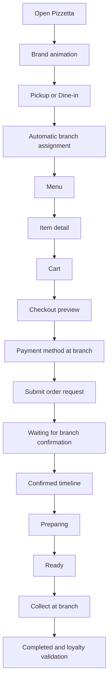
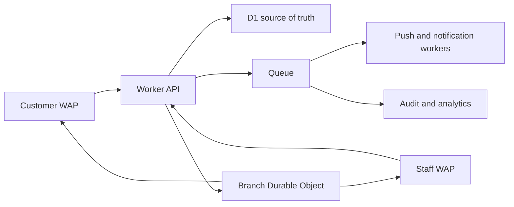

# PIZZETTA KIOSK
## World-class Product, UX, Operations and System Development Specification

Version: 1.0  
Date: 12 November 2026  
Product boundary: customer ordering WAP/PWA, restaurant operations WAP, future self-service kiosk

---

## 1. Product decision

Pizzetta is a sales and operations system for one restaurant brand with multiple branches. It has two connected surfaces:

1. Customer ordering surface for pickup and dine-in.
2. Restaurant operations surface for branch staff.

The customer never chooses the branch manually. The application assigns the best branch using scripts, GPS or device location, requested service, requested time, branch capacity, menu availability and current preparation time.

The product does not provide delivery. Payment is collected at the restaurant. The customer selects Cash or GCash so the branch knows how payment will be collected.

The system must make three promises:

- The customer can order quickly without calling or messaging the branch.
- The restaurant sees a reliable, prioritized operational queue.
- Pizzetta can use demand data to sell more during quiet periods, especially morning and lunch.

---

## 2. Product surfaces

### 2.1 Customer WAP/PWA

The customer surface is optimized for an iPhone 14 Pro viewport and remains usable on kiosk and desktop layouts.

Primary jobs:

- start a pickup or dine-in order;
- recover an active guest order after closing the browser;
- browse the current menu and item details;
- receive automatic branch assignment;
- choose a requested pickup or dine-in time;
- receive scripted upsells;
- select Cash or GCash for payment at the branch;
- follow preparation status;
- receive loyalty progress and reward availability.

### 2.2 Restaurant operations WAP

The staff surface is branch-focused and contains no administrative settings.

Primary jobs:

- receive new order requests;
- confirm or reject a request;
- see customer notes and structured responses;
- adjust waiting time with plus and minus controls;
- pause or resume new orders when authorized;
- advance the preparation pipeline;
- apply an eligible loyalty reward once;
- see late orders, scheduled orders and capacity pressure;
- communicate a structured response to the customer.

### 2.3 Self-service kiosk mode

The kiosk is a shared device. It starts from a clean state, uses the device branch as its location, and resets after inactivity. A guest can transfer tracking to a personal phone through a QR code after submitting an order.

---

## 3. Core interaction principles

### 3.1 One clear decision per screen

The customer should see one dominant action. The first screen asks only how the order will be fulfilled. The next screen shows the menu. The cart remains available without forcing the customer to navigate to a separate cart page.

### 3.2 Cards as the primary interaction unit

Cards represent service mode, item, meal, reward and order status. Each card has one purpose, one dominant action and one clear state.

Card states:

- available;
- selected;
- unavailable;
- sold out;
- scheduled;
- waiting for confirmation;
- confirmed;
- ready;
- expired.

### 3.3 Communication must be operational

The system uses short, structured messages. A staff member selects a response reason and may add a short note.

Supported response reasons:

- order accepted;
- requested time unavailable;
- new ready time;
- item unavailable;
- branch temporarily paused;
- customer note acknowledged;
- order ready;
- order cancelled by branch.

Every response becomes part of the order event history.

### 3.4 Motion has a purpose

The opening animation is short and skippable. Motion communicates state transitions, confirmation and readiness. Reduced-motion mode removes decorative movement while preserving state changes.

---

## 4. Customer journey



### 4.1 Opening

The opening sequence contains:

1. Paper background.
2. Pizzetta logo animation.
3. Optional short tagline.
4. Automatic branch assignment indicator.
5. Pickup and Dine-in cards.

The animation must not block the first action for more than 1.2 seconds. A skip action remains visible. The application stores no order data before the customer starts an order.

### 4.2 Fulfilment selection

The customer selects Pickup or Dine-in. This is the only explicit service decision.

The application then assigns a branch automatically.

The customer sees:

- assigned branch name;
- branch address;
- distance when GPS is available;
- estimated earliest service time;
- a short reason such as `Best match for your time` or `Closest branch with capacity`.

The customer does not choose from a branch list. A manual fallback exists only when GPS permission is unavailable or inaccurate. The fallback asks for a location or area and still lets the assignment engine decide.

### 4.3 Menu

Desktop and kiosk layout:

- left category rail;
- center-right item canvas;
- persistent footer cart;
- item detail drawer from the right.

Mobile layout:

- horizontal category rail;
- vertical item cards;
- fixed bottom cart bar;
- full-screen item detail sheet.

Each item detail includes:

- item name;
- price and format;
- ingredients;
- allergen labels limited to Wheat, Dairy, Nuts and Mustard;
- quantity controls;
- item note;
- add-ons;
- add to cart.

The menu is rendered from the server menu contract. Static client data is used only as a loading placeholder and must never determine the final price.

### 4.4 Scripted upsell sequence

The upsell engine is deterministic and rule-based.

First eligible pizza addition:

- offer Tropical Iced Tea at the promotional price when the promotion is active.

Eligible main item:

- offer Crust Meal when a pizza, spaghetti or lasagna is present.

Checkout:

- offer tea if no tea is in the cart;
- otherwise offer the missing salad or meal component;
- show at most one final recommendation.

The system records impression, accept, dismiss and conversion events. It never repeats an already dismissed upsell in the same order.

### 4.5 Checkout preview

The preview is server-calculated and contains:

- item lines;
- quantities;
- variants;
- add-ons;
- item notes;
- subtotal;
- loyalty eligibility;
- loyalty discount or reward status;
- final total;
- branch;
- service mode;
- requested time;
- estimated preparation time;
- Cash or GCash selection.

The customer must provide a name and WhatsApp number. A signed-in customer may reuse saved details after explicit confirmation.

### 4.6 Order request boundary

Submitting checkout creates an `order_request`, not an immediately confirmed kitchen order.

The request contains:

- request ID;
- idempotency key;
- customer identity when authenticated;
- guest continuity token when unauthenticated;
- assigned branch;
- service mode;
- requested time;
- item receipt snapshot;
- payment method choice;
- loyalty preview;
- expiry and retention metadata.

The branch confirms the request. Only after confirmation does the system create the operational order.

### 4.7 Tracking

Customer states:

- request received;
- waiting for branch confirmation;
- confirmed;
- preparing;
- packing or table service;
- ready;
- completed;
- cancelled.

The customer sees a countdown only when the branch has supplied a valid preparation estimate. A countdown is never shown as a promise before branch confirmation.

---

## 5. Automatic branch assignment engine

### 5.1 Inputs

The assignment engine accepts:

- customer latitude and longitude when permission is granted;
- device branch identifier for a kiosk;
- fallback area or address;
- service mode;
- requested service time;
- branch operating status;
- branch pause status;
- branch capacity windows;
- branch preparation time;
- item availability;
- menu and promotion eligibility;
- scheduled orders already assigned to each branch.

### 5.2 Assignment stages

```text
1. Detect location
2. Build eligible branch set
3. Remove closed or paused branches
4. Remove branches missing requested items
5. Calculate earliest achievable time
6. Compare requested time with branch capacity
7. Score distance, capacity and preparation fit
8. Select one branch
9. Return assignment explanation and slot
10. Revalidate before request creation
```

### 5.3 Candidate rejection rules

A branch is rejected when:

- it is closed at the requested time;
- the manager has paused new orders;
- an item is unavailable at that branch;
- capacity is full;
- the requested time is earlier than the achievable preparation time;
- the branch has a schedule conflict for dine-in;
- the branch is outside the configured service radius when GPS is reliable.

### 5.4 Scoring model

The first version is a transparent script, not a machine-learning model.

```text
score =
  distance_fit * 0.35
  + requested_time_fit * 0.30
  + capacity_fit * 0.20
  + item_availability_fit * 0.10
  + branch_load_balance * 0.05
```

The score is only used after hard rejection rules. A branch that cannot fulfil the order never wins because it is closer.

### 5.5 GPS states

The backend must distinguish:

- precise location;
- approximate location;
- permission denied;
- timeout;
- stale location;
- impossible coordinates.

When GPS is unavailable, the engine uses the customer-entered area and returns a lower-confidence assignment. The user sees a clear message and the branch assignment remains automatic.

### 5.6 Reassignment policy

Before order request creation, the engine may reassign the branch silently if the customer has not seen the assignment. After the customer has seen the receipt, reassignment requires a visible explanation and confirmation. After branch confirmation, reassignment is an operational exception handled by staff.

---

## 6. Location and map experience

### 6.1 Customer map

The map appears after branch assignment and during tracking. It shows:

- customer position when permission is available;
- assigned branch marker;
- walking or driving route link;
- distance;
- branch address;
- branch phone number;
- opening state;
- estimated pickup point.

The map does not become the first screen. Ordering remains the primary task.

### 6.2 Kiosk map

The kiosk uses the registered branch location. GPS is not requested from the guest. A compact branch map can be shown in the ready state for pickup guidance.

### 6.3 Technical rules

- MapLibre GL JS for rendering.
- GeoJSON for branch markers and route overlays.
- Server-side branch coordinates from D1.
- Route provider abstracted behind `/api/v1/maps/route`.
- Visible map attribution.
- Provider usage limits and caching documented.
- Route failure falls back to a map link and branch address.

---

## 7. Authentication, cookies and sessions

### 7.1 Customer authentication

Customer options:

- continue as guest;
- Google OAuth;
- Meta OAuth.

The customer can place the order as a guest. Sign-in is offered after the order request is submitted, so the ordering path remains fast.

When a guest signs in during an active request, the server can attach the request to the authenticated account only after validating the guest request token.

### 7.2 Guest continuity cookie

Cookie requirements:

```text
name: pz_request_token
HttpOnly: true
Secure: true
SameSite: Lax
Path: /
Max-Age: configured by retention policy
```

The token is random, stored only as a hash in D1 and never returned in the JSON payload. The request ID may be stored in localStorage because it is not an authorization secret.

### 7.3 Account session

The customer session uses a separate secure cookie. The session stores a hashed token, subject type, subject ID, expiry, provider and revocation timestamp.

### 7.4 Staff session

Staff login uses username and password for the current implementation. The session must also carry:

- staff ID;
- role;
- branch scope;
- issued time;
- expiry;
- last activity;
- revocation state.

The browser must never choose its own role or branch. The server derives both from the staff session.

### 7.5 Timeout policy

Customer browser:

- inactive menu timeout after a configurable period;
- warning before reset;
- cart cleared on reset;
- active submitted order preserved.

Kiosk:

- shorter inactivity timeout;
- visible countdown warning;
- reset to branch home;
- no customer contact retained in the next session.

Staff:

- session expiry after inactivity;
- reauthentication before sensitive operations;
- active queue reloaded after login;
- server-side revocation checked on every protected mutation.

---

## 8. Restaurant operations

### 8.1 Queue structure

The branch console has four operational lanes:

1. New requests.
2. Confirmed and waiting.
3. Preparing.
4. Ready for pickup or dine-in service.

Each card shows order number, service mode, requested time, current ETA, elapsed time, customer name, payment choice, reward flag and notes.

### 8.2 Staff actions

Cashier:

- confirm request;
- move order through preparation states;
- set or adjust waiting time;
- mark ready;
- apply an available loyalty reward.

Manager:

- all cashier actions;
- pause or resume orders;
- change branch waiting time;
- configure capacity windows;
- view operational metrics.

Admin:

- menu, branches, prices, rewards and system settings.

### 8.3 Waiting time control

The branch can adjust waiting time with plus and minus controls. The server applies a bounded delta and optimistic version check.

Every change records:

- previous wait time;
- new wait time;
- reason;
- staff actor;
- branch;
- affected open orders;
- timestamp.

### 8.4 Customer communication

There is no open-ended chat requirement. Use structured notes and responses. This keeps the interaction auditable and fast during service.

---

## 9. Loyalty mechanics

### 9.1 Qualification

An authenticated customer receives one validation only when an order is completed and the order subtotal is at least ₱299.

Guest orders do not add validations unless the guest signs in and the server securely links the order before completion.

### 9.2 Rewards

| Validation | Reward |
|---:|---|
| 3rd | 15% discount on the qualifying order |
| 6th | 30% discount on the qualifying order |
| 9th | Free classic 8″ pizza |
| 12th | Free classic 14″ pizza |

### 9.3 Redemption

Reward redemption is atomic. The server verifies:

- customer ownership;
- branch scope;
- reward status;
- order status;
- minimum order amount;
- correct classic pizza size for the free-pizza reward;
- current order version.

The reward changes to redeemed exactly once. A second request receives a conflict response and cannot create a second discount.

---

## 10. Intelligent calendar and demand prediction

### 10.1 Data collected

The data model records:

- branch;
- date and local time;
- service mode;
- requested time;
- confirmation time;
- preparation start;
- ready time;
- completion time;
- item categories;
- order value;
- cancellation reason;
- branch pause periods;
- capacity and wait-time changes.

### 10.2 Forecast unit

The initial forecast unit is a branch, day of week and 30-minute slot. This is easy to explain and works with limited data.

The forecast stores:

- observed order count;
- median preparation minutes;
- 80th percentile preparation minutes;
- cancellation rate;
- average basket value;
- confidence level;
- sample size.

### 10.3 Forecast rules

- Do not forecast when the sample is insufficient.
- Exclude branch closures and exceptional events from the baseline.
- Use recent data with a longer historical baseline.
- Increase preparation buffer when recent delays exceed the forecast.
- Let the manager override capacity with a logged reason.
- Never promise a slot that capacity cannot fulfil.

### 10.4 Commercial use

The system identifies:

- quiet morning windows;
- weak lunch slots;
- products with high margin and low preparation risk;
- branches with unused capacity;
- recurring abandoned carts;
- upsells that perform by time of day.

The promotion engine then chooses from predefined campaigns. Examples include Morning Coffee Pairing, Lunch Fast Pickup, Office Crust Meal and early-order Tropical Tea bundles.

---

## 11. Real-time event architecture



Event envelope:

```json
{
  "event_id": "uuid",
  "event_type": "ORDER_STATUS_CHANGED",
  "order_id": "uuid",
  "branch_id": "branch-poblacion",
  "from_version": 4,
  "to_version": 5,
  "actor_type": "STAFF",
  "occurred_at": "ISO-8601",
  "payload": {}
}
```

The customer and staff clients reconnect using the last event ID. If an event is missed, the client requests a complete order snapshot. D1 remains authoritative.

---

## 12. API contracts to develop

### Customer

```text
GET    /api/v1/assignment/preview
POST   /api/v1/checkout/preview
POST   /api/v1/order-requests
GET    /api/v1/order-requests/:id
GET    /api/v1/orders/:id
GET    /api/v1/customer/loyalty
GET    /api/v1/customer/history
POST   /api/v1/customer/favorites
GET    /api/v1/maps/route
GET    /api/v1/realtime/branch/:branchId
```

### Staff

```text
GET    /api/v1/staff/branches/:branchId/requests
POST   /api/v1/staff/order-requests/:id/confirm
PATCH  /api/v1/staff/orders/:id/status
POST   /api/v1/staff/orders/:id/loyalty-redeem
PATCH  /api/v1/staff/branches/:branchId/operations
GET    /api/v1/staff/branches/:branchId/capacity
GET    /api/v1/staff/branches/:branchId/forecast
POST   /api/v1/staff/orders/:id/message
```

Every mutation requires idempotency and optimistic version checks.

---

## 13. Failure states

The interface must have designed states for:

- GPS denied;
- GPS timeout;
- branch closed;
- branch paused;
- requested slot full;
- product sold out;
- branch confirmation delayed;
- order late;
- network disconnected;
- session expired;
- duplicate submit;
- reward already redeemed;
- invalid staff role;
- notification permission denied.

Each state contains one explanation, one next action and one recovery path.

---

## 14. Development sequence

### P0 — Repository and runtime boundary

- isolate Pizzetta files;
- remove legacy imports and tests from the Pizzetta build;
- create local, preview and production Wrangler configs;
- add environment invariant checks.

### P1 — Canonical server contracts

- server menu response becomes the sole client menu source;
- checkout preview becomes mandatory;
- pricing, availability and reward rules share one server function;
- payment contract becomes Cash or GCash collected at branch.

### P2 — Automatic branch assignment

- implement location capability states;
- implement eligibility filters;
- implement scoring and explanation;
- add assignment test matrix for all three branches.

### P3 — Client UX system

- opening animation;
- card states;
- item detail sheet;
- persistent cart;
- upsell rules;
- timeout and reset behavior;
- reduced motion.

### P4 — Staff operations

- request queue;
- confirm/reject flow;
- ETA controls;
- structured messages;
- loyalty redemption;
- late order lane.

### P5 — Real-time transport

- branch Durable Object;
- event envelope;
- reconnect and snapshot reconciliation;
- polling fallback.

### P6 — Maps and customer tracking

- MapLibre layer;
- branch marker;
- customer position;
- route link;
- attribution and provider monitoring.

### P7 — Calendar and demand

- event aggregation;
- slot capacity;
- forecast table;
- manager override;
- morning and lunch promotion rules.

### P8 — Verification and release

- Pizzetta-only tests;
- browser E2E on iPhone 14 Pro dimensions;
- kiosk timeout tests;
- role and branch isolation tests;
- loyalty concurrency tests;
- preview deploy;
- production rollback procedure.

---

## 15. Acceptance criteria

The product is ready for controlled branch use when:

- automatic assignment chooses a branch without a branch picker;
- assignment remains deterministic for identical inputs;
- server pricing matches displayed checkout totals;
- guest order recovery works after browser restart;
- staff can confirm, delay, pause and advance orders;
- customer receives live status or a safe snapshot fallback;
- every loyalty reward can be redeemed once;
- free pizza rewards require the correct classic size;
- calendar slots never exceed branch capacity;
- morning and lunch campaigns are measurable;
- no Pizzetta build imports Boutique Rooms files;
- all Pizzetta tests pass;
- production configuration identifies production correctly;
- accessibility and reduced-motion checks pass;
- operational failures have a visible recovery path.

---

## 16. Current status

The current repository has working menu, branches, order requests, staff queue, loyalty schema and local build foundations. The product remains in architecture and hardening phase. The next implementation gate is the P0 repository boundary, followed by automatic branch assignment and server checkout preview.

